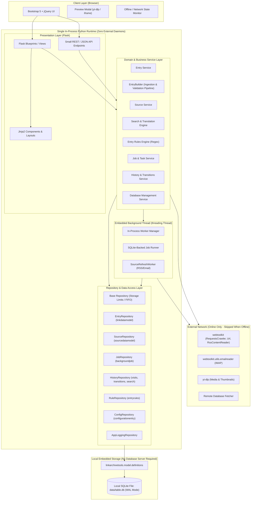
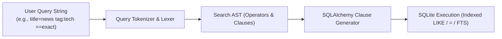
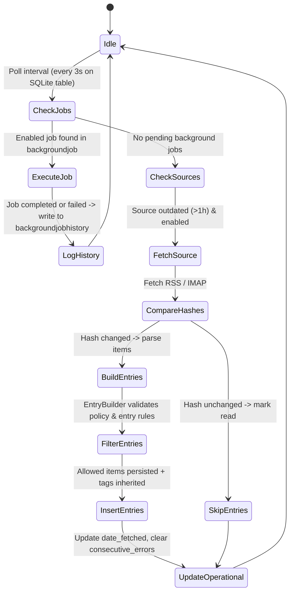
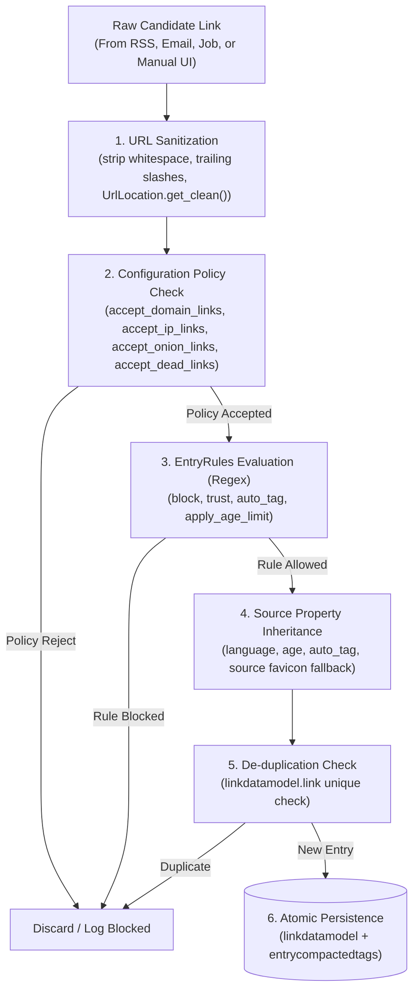

# YAFR Architecture Specification

> [!IMPORTANT]
> **Zero External System Programs Policy**:
> YAFR requires **zero external programs, system services, or message brokers** to be installed on the operating system.
> - **NO RabbitMQ, Redis, Kafka, or Celery**.
> - **NO system daemons, background services, or Docker containers**.
> - The application runs as a web server, and a worker
> - The task queue is backed entirely by the local SQLite database file (`backgroundjob` table).
> - Asynchronous execution is handled strictly via Python standard library in-process daemon threads (`threading.Thread`).
> - The user only runs `poetry run python run.py` — nothing else needs to be installed or configured on the system.

---

## 1. Architectural Overview

YAFR (Yet Another Feed Reader / Link Archive Search Application) is a self-hosted, lightweight web application designed for offline-first querying and cataloging of web links, feeds, and multimedia entries backed by a local SQLite database.

The application follows an **Extended Model-View-Controller (MVC) and Layered Repository Pattern**, strictly decoupling presentation logic from business services, data persistence, and asynchronous background execution.

---

## 2. Selected Libraries & Technology Stack

All libraries are pure Python packages installed within the local Python virtual environment (`poetry`). No system-level software or daemon is ever required.

### 2.1 Backend Core & Web Framework

| Library | Version / Constraint | Primary Responsibility | Justification & Architectural Fit |
| :--- | :--- | :--- | :--- |
| **Python** | `>= 3.10` | Runtime environment | Standard modern Python environment supporting type annotations and pattern matching. |
| **Flask** | `^3.0` | HTTP Application Server & Routing | Minimalist, un-opinionated, fast startup, zero background services. Runs directly in-process. |
| **Jinja2** | Included with Flask | Server-side HTML templating | Supports modular template components (search bar, polymorphic entry cards, pagination, modals). |
| **Werkzeug** | Included with Flask | WSGI utilities & request handling | Built-in secure parameter handling, URL helpers, and HTTP exceptions. |

### 2.2 Database & Object-Relational Mapping (ORM)

| Library | Version / Constraint | Primary Responsibility | Justification & Architectural Fit |
| :--- | :--- | :--- | :--- |
| **SQLAlchemy** | `>= 2.0` | ORM & SQL Expression Builder | Used natively by `linkarchivetools.model.definitions`. Provides session management and query compilation without any external database daemon. |
| **SQLite3** | Standard Library | Embedded Relational Database | Built directly into Python. Operates on the active local database file (defaulting to `data/table.db` for testing/development). Configured with `PRAGMA journal_mode=WAL` for concurrent reads/writes between web requests and background threads. |
| **linkarchivetools** | `^1.0.37` | Authoritative Data Model & Schemas | Defines SQLAlchemy mapped classes (`LinkDataModel`, `SourcesTable`, `SourceOperationalData`, `SearchView`, `ConfigurationEntry`, `BackgroundJob`, `EntryRules`, etc.). |

### 2.3 Networking, Scraping & Feeds

| Library | Version / Constraint | Primary Responsibility | Justification & Architectural Fit |
| :--- | :--- | :--- | :--- |
| **webtoolkit** | Dependency of linkarchivetools | HTTP requests, RSS reading, URL utilities | Required by project specification (`webtoolkit.Url`, `RequestsCrawler`, `RssContentReader`, `DateUtils`, `ContentInterface`). |
| **requests** | `^2.31` | Low-level HTTP Client | Underlying engine for network transfers, header simulation, timeouts, and redirects. |
| **beautifulsoup4** | `^4.12` | HTML parsing & DOM extraction | Used for metadata scraping, favicon extraction, OpenGraph tags, and XPath fallback parsing. |
| **yt-dlp** | `^2026.8.19` | Video & Rich Media Extraction | Metadata extraction for video feeds (YouTube, Odysee, etc.), high-res thumbnail resolution, and embed validation. |
| **webtoolki** | Standard Library | Email Source Fetching | contains utils for reading emails. |

### 2.4 Asynchronous Worker & Task Queue (Zero External Programs)

| Mechanism | Source | Primary Responsibility | Justification & Architectural Fit |
| :--- | :--- | :--- | :--- |
| **threading.Thread** | Python Standard Library | Embedded background worker daemon | Runs in the background of the application process. Starts and stops cleanly with the app. Requires zero external daemons or system setup. |
| **SQLite Table `backgroundjob`** | Local SQLite Database | Persistent task queue | Serves as the queue storage. Persists jobs across application restarts without needing any message broker. |

> [!NOTE]
> **Why External Message Brokers Are Explicitly Avoided**:
> Systems like RabbitMQ, Redis, Kafka, or Celery require installing standalone servers and background daemons on the host OS. YAFR's embedded design uses the local SQLite `backgroundjob` table as the queue and an in-process Python thread as the consumer, achieving complete independence from external system programs.

### 2.5 Frontend Framework & Client-Side Libraries

| Library | Delivery Method | Primary Responsibility | Justification & Architectural Fit |
| :--- | :--- | :--- | :--- |
| **Bootstrap 5** | Local static asset (`bootstrap.min.css`, `bootstrap.bundle.min.js`) | Responsive layout, components, modal dialogs | Required by project specification. Enables grid layout, responsive navigation, cards, badges, and progress bars. |
| **Bootstrap Icons** | Local static font/CSS (`bootstrap-icons.css`) | Application icons | Standard vector icons for search, skull (dead status), bookmarks, refresh spinners, tags, and votes. |
| **jQuery** | Local static asset (`jquery-3.7.1.min.js`) | DOM manipulation & AJAX requests | Specified by project requirements. Enables concise AJAX calls to small JSON endpoints, dynamic partial DOM updates, and modal triggers. |

### 2.6 Development, Formatting & Testing

| Library | Version / Constraint | Primary Responsibility |
| :--- | :--- | :--- |
| **unittest** | Python Standard Library | Test runner for repositories, services, workers, and route tests (`make test` / `python -m unittest discover tests`) |
| **black** | `^25.9.0` | Code formatting standard |
| **flake8** | `^7.0` | Linting and code quality checks |

---

## 3. Subsystem Architecture

### 3.1 Repository & Data Access Layer

To avoid duplicating database access logic, all raw SQLAlchemy operations are encapsulated in strongly typed **Repositories**.

1. **BaseRepository**:
   - Manages SQLite sessions via scoped session factories.
   - Provides generic CRUD methods (`get_by_id`, `add`, `update`, `delete`, `list_all`).
   - Implements FIFO storage eviction via `apply_storage_limit(table, limit_column, max_entries)` to satisfy storage limit requirements for history tables.

2. **EntryRepository (`linkdatamodel`)**:
   - Implements query compilation for search expressions.
   - Handles multi-table dependent deletions:
     - Deletes dependent rows in `entrycompactedtags`, `socialdata`, `readlater`, and `entryvisithistory` before deleting the parent `linkdatamodel` entry.
   - Updates status codes (`manual_status_code`: 200 for active, 400 for dead).
   - Manages tags via `entrycompactedtags` and global counts in `compactedtags`.

3. **SourceRepository (`sourcedatamodel`, `sourceoperationaldata`)**:
   - Manages RSS, Email, and Parse sources.
   - Resolves source operational metrics (entries count, `consecutive_errors`, `page_hash`, `body_hash`, `date_fetched`).
   - Handles cascading deletion of operational data and associated link data when a source is removed.

4. **JobRepository (`backgroundjob`, `backgroundjobhistory`)**:
   - Fetches prioritized enabled jobs (`priority ASC`, `date_created ASC`) directly from SQLite.
   - Updates error counts and disables failing jobs exceeding threshold.
   - Moves completed tasks to `backgroundjobhistory`.

5. **HistoryRepository**:
   - **SearchHistory**: Stores user queries up to `max_number_of_user_search` (default 50-100).
   - **EntryVisitHistory**: Tracks visit counts and timestamps up to `max_user_entry_visit_history`.
   - **EntryTransitionHistory**: Records directed transitions (`entry_from_id` -> `entry_to_id`) for navigation flow panes.
   - **ReadLater**: Manages bookmarking items for later reading.

6. **ConfigRepository (`configurationentry`)**:
   - Reads and caches application settings (active display style, display type, alpha values, storage limits).

7. **LoggingRepository (`applogging`)**:
   - Implements structured logging into the `applogging` SQLite table with standard severity levels (`DEBUG`, `INFO`, `WARNING`, `ERROR`, `CRITICAL`).

---

### 3.2 Search Translation & Query Engine

Search is the primary function of the application. Queries execute locally against SQLite indexes with zero internet dependency.

#### Search Translation Grammar & Rules:
1. **Operator Translation**:
   - Single equal (`field=value`): Translated to SQL `LIKE '%value%'` (case-insensitive substring match).
     - Example: `title=youtube` -> `linkdatamodel.title LIKE '%youtube%'`
   - Double equal (`field==value`): Translated to SQL exact match `=` (`linkdatamodel.field = 'value'`).
     - Example: `title==linux` -> `linkdatamodel.title = 'linux'`
   - Free text (`term`): Translated to composite `(title LIKE '%term%' OR description LIKE '%term%')`.
   - Negation (`!field=value` or `-term`): Translated to SQL `NOT LIKE` or `!=`.
2. **Field Routing**:
   - Supported fields: `title`, `description`, `link`, `author`, `language`, `tag`, `status`.
3. **Ordering Clauses**:
   - Supports explicit or dropdown-selected sorting:
     - `order:votes` -> `ORDER BY linkdatamodel.page_rating_votes DESC`
     - `order:published` -> `ORDER BY linkdatamodel.date_published DESC`
     - `order:created` -> `ORDER BY linkdatamodel.date_created DESC`
     - `order:visits` -> `ORDER BY linkdatamodel.page_rating_visits DESC`
     - `order:followers` -> `ORDER BY socialdata.followers_count DESC`
     - `order:stars` -> `ORDER BY socialdata.stars DESC`
4. **Pre-defined System Filters**:
   - **Visited Filter**: Joins `entryvisithistory` where `visits > 0`.
   - **Read Later Filter**: Joins `readlater` where `readlater.entry_id = linkdatamodel.id`.
   - **by Date published**: Default fallback ordering filter.
   - **by Votes**: Orders by `page_rating_votes DESC`.
   - **by Visits**: Orders by `page_rating_visits DESC`.

---

### 3.3 Embedded Asynchronous Worker (In-Process)

The application runs a lightweight background daemon thread (`WorkerDaemon`) within the single Python process:

#### Worker Operation Rules:
1. **BackgroundJob Execution**:
   - Reads directly from the local SQLite `backgroundjob` table.
   - Recognizes job constants:
     - `JOB_PROCESS_SOURCE`, `JOB_LINK_UPDATE_DATA`, `JOB_LINK_RESET_DATA`, `JOB_LINK_DOWNLOAD_SOCIAL`, `JOB_RUN_RULE`, `JOB_CLEANUP`, `JOB_TRUNCATE_TABLE`.
   - **`JOB_LINK_UPDATE_DATA = "link-update-data"` Execution**:
     - Obtains URL handler like in `webtools_service.py` (`BaseUrl` or `RemoteUrl` based on active configuration).
     - Executes network request and invokes BaseUrl/RemoteUrl metadata extractors directly (get_title, get_description, date_published, author, etc.). No fallback to raw response or BeautifulSoup HTML parsing; either BaseUrl/RemoteUrl works, or not.
     - Updates entry (`linkdatamodel`) with title, description, date_published, author, album, language, thumbnail, HTTP `status_code`, and `date_dead_since`. Enqueues `JOB_LINK_DOWNLOAD_SOCIAL`.
   - Executes jobs sequentially based on priority.
   - Records errors in `backgroundjob.errors`. If consecutive failures exceed max retries (3), disables the job (`enabled = False`) and creates an entry in `applogging`.
2. **SourceRefreshWorker & Outdated Jobs Handling**:
   - Triggered when no explicit `BackgroundJob` tasks are pending.
   - When the job queue is empty, outdated sources (> 1h since last fetch) are enqueued or automatically refreshed.
   - **Filter Rules**:
     - Disabled sources (`enabled = False`) are strictly skipped.
     - Sources fetched within the last hour (`datetime.now() - date_fetched < 1 hour`) are skipped unless explicitly triggered by user pull-to-refresh.
     - Sources ordered by oldest `date_fetched` or `date_fetched IS NULL`.
   - **Operational Hash Check**:
     - Computes binary SHA-256 hashes (`page_hash` and `body_hash`).
     - If hashes match `sourceoperationaldata`, payload parsing is skipped, saving compute and disk I/O.
   - **EntryBuilder Ingestion**:
     - All parsed feed items are processed through `EntryBuilder` to enforce link acceptance rules, sanitize URLs, match `EntryRules` regexes, and inherit source properties.
   - **Error Tracking**:
     - If fetch succeeds: `consecutive_errors` reset to `0`, `date_successful_fetch` updated.
     - If fetch fails: `consecutive_errors` incremented by `1`.
     - Sources with consecutive errors display an error badge in the UI.

---

### 3.4 Email Source Integration & Webtoolkit Patch Note

use via import webtoolkit/utils/emailreader.py

---

### 3.5 UI Component & Display Style System

The presentation layer supports dynamic configuration switching via user preferences stored in `ConfigurationEntry`:

#### 1. Display Themes:
- `DISPLAY_STYLE_LIGHT` (`style-light.css`): High-contrast clean daylight theme.
- `DISPLAY_STYLE_DARK` (`style-dark.css`): Low-glare dark palette.

#### 2. Display Card Layouts (Polymorphic Entry Views):
- `DISPLAY_TYPE_STANDARD`: Feed-reader style layout with thumbnail on the left, title, source, published date, tags, and actions on the right.
- `DISPLAY_TYPE_GALLERY`: YouTube / TikTok style visual card with large thumbnail preview, duration/social indicators, and compact metadata below.
- `DISPLAY_TYPE_SEARCH_ENGINE`: Google / DuckDuckGo style layout with emphasis on hyperlinked title, breadcrumb source URL, and matching snippets.
- `DISPLAY_TYPE_CONTENT_CENTRIC`: Reddit / forum style card with expanded description, clickable in-line links, full social metrics bar, and comment actions.
- `DISPLAY_TYPE_LINKS_ONLY`: High-density tabular / compact list for power users.

#### 3. Visual Transparency (Alpha) Rules:
- **Visited Alpha** (`entries_visit_alpha`, default `0.6`): Applied to entries found in `entryvisithistory` to fade out already read content.
- **Dead Alpha** (`entries_dead_alpha`, default `0.4`): Applied to entries with `manual_status_code = 400` or dead status.
- **Opaque Override**: Bookmarked entries (`bookmarked = True`) or entries with user votes (`page_rating_votes != 0`) strictly remain **100% opaque** regardless of visit status.

---

### 3.6 Entry Ingestion & Builder Pipeline (`EntryBuilder`)

To prevent raw URLs, malformed schemes, and blocked links from polluting `linkdatamodel`, all candidate links from workers, feeds, background jobs, or manual user input pass through a centralized **`EntryBuilder`** domain service before persistence.

#### Ingestion Pipeline Responsibilities:
1. **URL Sanitization & Normalization**:
   - Strips leading and trailing whitespace.
   - Cleans URL using `webtoolkit.UrlLocation.get_clean()`.
   - Removes superfluous trailing slashes.
   - Honors `prefer_https_links` (upgrading scheme) and `prefer_non_www_links` (stripping `www.`).
2. **Ingestion Policy Validation (`ConfigurationEntry`)**:
   - Rejects non-domain URLs unless `accept_non_domain_links` is enabled.
   - Evaluates `accept_ip_links` for IPv4/IPv6 addresses.
   - Evaluates `accept_onion_links` for Tor darknet addresses.
   - Evaluates `accept_dead_links` if status indicates an HTTP error.
3. **Regex Rule Matching (`EntryRules`)**:
   - Evaluates active regex patterns configured in `entryrules`:
     - **Block**: Rejects link and aborts ingestion.
     - **Trust**: Marks entry as active/trusted (`manual_status_code = 200`).
     - **Auto-tag**: Appends configured tags to the entry.
     - **Age limit**: Applies `apply_age_limit` if positive.
4. **Source Attribute Inheritance**:
   - If an entry originates from a `SourcesTable` source:
     - Inherits `source.language` if entry language is undefined.
     - Inherits `source.age` if entry age is undefined.
     - Automatically attaches `source.auto_tag` to entry tags.
     - Falls back to `source.favicon` if entry thumbnail is missing.
5. **De-duplication**:
   - Verifies whether canonical link already exists in `linkdatamodel` to guarantee idempotency across feed updates.

#### 3.6.1 Interactive Link Addition UI & Propositions
Users can add links manually via the Quick Add modal accessible from the navbar and `EntriesListView`, or via `EntryEditScreen` (`/entries/new`):
- **Live Link Validation (`/api/entries/validate-link`)**: As the user enters a link, client-side input triggers debounced validation.
- **Clickable Proposition Chips**: Suggests normalized versions that replace the input on click:
  - Cleaned canonical URL (`webtoolkit.UrlLocation.get_clean()`).
  - Version without superfluous trailing slash.
  - Version with `www.` stripped.
  - Version upgraded to `https://`.
- **Policy & Rule Feedback**: Real-time feedback if a link violates domain, IP, Tor onion, or dead link policies, with an option to override for manual additions. Alerts if a link is blocked by `EntryRules`.
- **Batch Link Ingestion (`/api/entries/batch-add`)**: Textarea allowing pasting up to 200 URLs at once, sanitized and de-duplicated through `EntryBuilder`.
- **Asynchronous Metadata Fetching (`JOB_LINK_UPDATE_DATA`)**: When links are added by the user (via Quick Add, Batch Ingestion, or New Entry screen), a `JOB_LINK_UPDATE_DATA = "link-update-data"` job is enqueued. The worker thread fetches `BaseUrl`/`RemoteUrl` metadata (title, description, date_published, author, thumbnail, etc.) via `WebToolsWrapper` to populate entry metadata directly without fallback to raw response or BeautifulSoup parsing.

---

### 3.7 Offline Resilience & Graceful Degradation

1. **Local Independence**:
   - Searching, filtering, viewing details, editing tags, voting, and reading visit history require **no internet connection**.
2. **Network State Detection**:
   - The UI includes client-side network detection (`window.addEventListener('online')` / `'offline'`).
   - Server health endpoint `/api/status/health` reports internet availability.
3. **Control State Management**:
   - When offline, network-bound controls (e.g., "Fetch All Sources", "Download Remote DB", "Update Social Data") are automatically **hidden or disabled** with explanatory tooltips.
   - Operations that fail due to connection timeouts report descriptive SQLite/Network alerts without corrupting the local database.

---

## 4. Security & Safety Principles

1. **Destructive Operations Confirmation**:
   - All destructive actions (deleting entries, clearing search history, clearing visit logs, deleting sources, replacing databases) trigger a Bootstrap confirmation modal requiring explicit user consent.
2. **Local Database Protection**:
   - Database replacements from remote URLs are downloaded to a temporary location (`.tmp_db`), validated with `PRAGMA quick_check;`, and atomic swapped to prevent file corruption.
3. **Storage Caps (Anti-Bloat)**:
   - History tables enforce rolling retention caps:
     - Search history capped at `max_number_of_user_search` rows.
     - Visit history capped at `max_user_entry_visit_history` rows.
     - Oldest rows are removed via FIFO deletion triggers during insertion.
